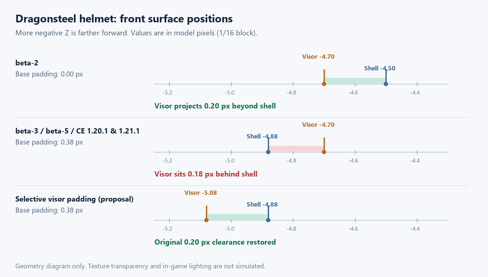

# #273：护甲立体部件被外壳遮挡的分析

本文记录初始调查时的状态；后续 1.21.1 修复及验证见 [修复记录](issue-273-armor-fix.md)。

分析日期：2026-11-13。范围：用户提供的原版 1.20.1 beta-2、beta-3、beta-5 JAR，以及 CE 的 1.20.1、1.21.1、26.1.2 三个分支。本次只分析，没有修改生产代码。

## 结论

可以定位到上游遗留的模型尺寸问题：基础人形模型增加了膨胀量，面罩、肩甲等自定义部件仍沿用未膨胀时的尺寸。头部还存在一层额外膨胀 `0.5` 的 `hat` 外壳，导致问题在龙钢头盔上尤其明显。模型部件仍存在，但被外壳的不透明纹理遮挡；无需假设面法线翻转或模型丢失，就能解释 #273 的截图。

**本次提供的 beta-3 和 beta-5 中，全部护甲模型类、护甲物品类及护甲纹理均相同。实际可确认的模型改动发生在 beta-2 → beta-3。** 因此，“beta-3 正常、后续版本才出现问题”的反馈需要结合当时实际加载的文件和运行环境再核对，不能直接作为这批 JAR 的版本分界。

CE 三个分支均保留了导致遮挡的尺寸关系。修复适合直接调整护甲模型代码，不需要大量 Mixin 或修改纹理。

## JAR 对比证据

对三个文件进行 ZIP 条目内容比较和 SHA-256 校验，使用本地 Vineflower 1.11.2 反编译护甲类，并用 `javap -c -p` 核对静态初始化逻辑。比较的是解压后的实际内容，不受 ZIP 时间戳和压缩方式影响。

| 检查项 | beta-2 → beta-3 | beta-3 → beta-5 |
| --- | --- | --- |
| `ArmorModelBase` | 新增 `INNER_MODEL_OFFSET = 0.38F`、`OUTER_MODEL_OFFSET = 0.45F` | 字节完全相同 |
| 11 个具体护甲模型类 | 静态烘焙由 `CubeDeformation.NONE` 改为增加上述偏移；同时清理旧字段/构造函数 | 11/11 字节完全相同 |
| 11 个模型的完整网格工厂方法 | 全部相同，包含部件尺寸、UV、父子关系及旋转/位移 | 全部相同 |
| 69 张 `textures/models/armor/` 纹理 | 69/69 字节完全相同 | 69/69 字节完全相同 |
| 护甲物品相关类（含内部类） | 重点检查的龙钢护甲渲染入口未变 | 24/24 字节完全相同 |
| `ClientProxy`、`IafClientSetup` | 字节完全相同 | 字节完全相同 |

11 个具体模型涵盖铜、死亡蠕虫、三种龙钢、三种龙鳞、海蛇、银、巨魔护甲。它们都经历了“只扩大基础模型、保留附加部件原尺寸”的改动；实际可见程度需要逐个部件判断。

三个输入文件的 SHA-256：

```text
beta-2  6a27cdab2497cac35f136acf537bdfdf5cea7cfdf866e96a709cc5e49031f154
beta-3  d1141d27ef5e700a21f414f86f3a749753e3f61b182629582982168b47c15e59
beta-5  2b80245fc9b7d6fdc61d71f9892f4c6114eb7f303f65634845aaab25f84d1e82
```

作为单个类的复核依据，beta-3 和 beta-5 的 `ModelDragonsteelIceArmor.class` 均为：

```text
0c4971704dafdf93097d95d1a34a278de8407e6594b17d04a9a4026258b4f0e6
```

文件名也不能完全代替内部版本信息：用户提供的 beta-5 文件在 MANIFEST 中将 `Implementation-Version` 写为 `2.1.13-1.20.1`，而 beta-3 明确写为 `2.1.13-1.20.1-beta-3`。上表始终按本次实际输入文件识别版本。

## 上游历史已经出现过同类回归

1. [2023-03-22，`2a8ca936`](https://github.com/AlexModGuy/Ice_and_Fire/commit/2a8ca9368cbbecc698953ae1ca3e7ea0b5cb504a)：提交信息为 `Fixed armor models being different. Resolves #4794`。例如冰龙钢护甲由原版 `INNER_ARMOR_DEFORMATION / OUTER_ARMOR_DEFORMATION` 改为 `CubeDeformation.NONE`，解决了旧的[护甲模型异常反馈 #4794](https://github.com/AlexModGuy/Ice_and_Fire/issues/4794)。
2. [2024-02-17，`e020c86d`](https://github.com/AlexModGuy/Ice_and_Fire/commit/e020c86da327db4c4e73f9bea48caa1e7e7b1652)：为避免与玩家皮肤第二层穿模，重新引入 `0.38 / 0.45` 的基础膨胀量，并移除了隐藏玩家皮肤外层的旧逻辑。附加部件的网格定义没有同步调整。
3. 本次 beta-2 不含第二次改动，beta-3、beta-5 均已包含。CE 继续保留了这套基础膨胀量与附加部件尺寸。

这解释了为什么问题可能长期被带入后续移植：上游为解决皮肤外层穿模所作的调整，重新改变了先前已经修过的护甲相对尺寸。

## 冰龙钢头盔的定量证据

`HumanoidModel.createMesh(deformation, offset)` 同时创建 `head` 和 `hat`。`head` 使用传入的膨胀量 `d`，`hat` 使用 `d + 0.5`。这里的 `hat` 是护甲模型本身的第二层几何，并不等同于玩家皮肤是否开启帽子层。原版护甲槽位可见性逻辑会同时开启这两层。

冰龙钢模型两个 `visor` 的立方体定义没有传入膨胀量。例如 `visor1`：

```java
addBox(-4.7F, -13.3F, -4.9F, 4, 5, 8)
// PartPose.offset(0.0F, 9.0F, 0.2F)
```

加上局部位移后，范围为 `X=[-4.7,-0.7]`、`Y=[-4.3,0.7]`、`Z=[-4.7,3.3]`。另一半是对称的 `X=[0.7,4.7]`。这些面罩尺寸在三个输入 JAR 和 CE 中都保留。

| 场景 | 基础膨胀量 d | `hat` 前表面 Z | 面罩前表面 Z | 相对位置 |
| --- | ---: | ---: | ---: | --- |
| 原版 beta-2 头盔 | 0 | -4.50 | -4.70 | 面罩突出外壳 0.20 |
| 原版 beta-3 / beta-5，CE 1.20.1 / 1.21.1 头盔 | 0.38 | -4.88 | -4.70 | 面罩埋入外壳 0.18 |
| CE 26.1.2 当前头盔渲染入口 | 0.45 | -4.95 | -4.70 | 面罩埋入外壳 0.25 |

单位是模型像素，即方块的 1/16；Z 越负越靠前。

当 `d=0.38` 时，`hat` 的范围为 `X/Z=[-4.88,4.88]`、`Y=[-8.88,0.88]`，**两块面罩的整个几何范围都已落入外壳内部**。纹理存在透明窗口，所以并非每个角度、每个像素都完全不可见；不透明区域会挡住内部面罩。冰龙钢纹理的 `hat` 正面 UV 区域并非空白，8×8 的区域中有 46 个非透明像素。这与截图中“外面看不到、从里面能看到”的现象一致。



图为坐标分析示意，并非游戏截图。第三行仅演示对面罩增加同等膨胀量时的前表面关系，未实施或完成视觉验证。

## 肩甲与其他部件

同样的问题不只发生在 `hat`：

- 龙钢肩甲 `sleeveRight / sleeveLeft` 的前表面为 `Z=-2.4`，旋转只绕 Z 轴，不改变这一前后坐标。基础手臂在 `d=0.45` 时已扩到 `Z=-2.45`，因此外层手臂可遮挡原本凸出的肩甲前面。未膨胀时该部件原本有 0.4 的突出量。
- 龙钢下摆深度为 `Z=±2.5`，基础腿部在 `d=0.38` 时为 `±2.38`，仍在外面，但原本 0.5 的间距缩小为 0.12。不能把所有部件统一描述成“完全消失”。
- 海蛇护甲肩套同样保留 `Z=±2.5`，基础手臂外扩到 `±2.45` 后，只剩 0.05 的前后间距；鳍和肩套仍采用原尺寸。
- 龙鳞护甲的下颌、额部、角、背刺等也没有接收基础膨胀量；需要按形状与旋转分别检查。不能用龙钢面罩的具体数值代替所有模型的结论。

## CE 三个分支的对应位置

| 分支 | 主要实现 | 判断 |
| --- | --- | --- |
| 1.20.1 | `common/src/main/java/.../render/model/armor/ModelDragonSteelIceArmor.java`，`render/armor/DragonSteelArmorRenderer.java` | 头盔选 inner 模型，`d=0.38`；面罩无额外膨胀 |
| 1.21.1 | `src/main/java/.../render/model/armor/DragonSteelIceArmorModel.java`，`render/item/armor/BasicArmorRenderer.java` | `HEAD` 与 `LEGS` 选 inner 模型，`d=0.38`；面罩无额外膨胀 |
| 26.1.2 | 同名模型，`ArmorMeshParts.java`，`BasicArmorRenderer.java` | 除 `HUMANOID_LEGGINGS` 外选 outer 模型，头盔 `d=0.45`；面罩无额外膨胀 |

26.1.2 的 `hat` 移到了 `head` 下面，槽位裁剪保留头部及其子部件；这项 API 变化没有消除尺寸不匹配。修复时应沿用各版本已有的父子结构和槽位裁剪。

CE 的龙钢冰/火主纹理与原版 beta-3 按内容校验相同，现代分支主要是改了资源文件名，例如 `armor_dragonsteel_ice.png` → `dragonsteel_ice_layer_1.png`。没有发现需要通过替换这些纹理解决问题的依据。

## 建议的修复方向

优先保留基础护甲防止皮肤穿模的膨胀量，对附着于外壳的板状部件进行同步补偿：龙钢面罩、肩甲/袖套、下摆，以及其他护甲中同类结构。对合适的立方体使用 `addBox(..., deformation)`，必要时对旋转部件单独调整位置。

以冰龙钢面罩为例，同步增加 `0.38` 后，其前沿变为 `-5.08`，相对 `hat` 的 `-4.88` 恢复 0.20 的突出量。这可以直接解决已经证明的包裹关系，同时保留基础外壳的防穿模空间。但它不保证整套模型与 beta-2 完全同形，仍需游戏内比较。

不建议把全部角、尖刺、鳍直接套上相同的三轴膨胀量：这些独立突出结构会变粗，零厚度部件也可能被改变形状。也不建议一律删除/隐藏 `hat`：它使用真实的头盔纹理，部分护甲还有附在该层上的装饰，删掉会改变原有外观。

如果目标是严格恢复 beta-2 的轮廓，另一条路线是将基础膨胀恢复为 0，并单独处理玩家皮肤外层穿模。这能恢复旧的部件相对尺寸，但也会重新遇到上游 2024 年那次提交要解决的问题，改动范围更大。不要只回退偏移量就认为全部问题已解决。

这些调整应放在 CE 的模型构建处，不应直接修改 Uranus 的共享常量；26.1.2 还有 `ArmorMeshParts` 中的偏移值，且实际渲染经过按槽位烘焙，不能只改静态模型构造函数。

## 修复后的验证建议

1. 对冰/火/电龙钢头盔在相同视角比较正面、侧面、下方和内部：检查面罩在外壳之外、眼部开口和角的外观。护甲架可隔离玩家皮肤外层影响。
2. 再检查龙鳞、海蛇及其他采用相同构建方式的护甲；分别穿单件与整套，观察肩甲、下摆及不同槽位的重叠。
3. 玩家使用标准/纤细手臂、开启皮肤第二层，测试站立、潜行、抬臂和行走，确认修复没有重新带入皮肤穿模。
4. 在三个 CE 版本分别运行客户端。模型坐标断言可覆盖面罩与外壳的相对边界；服务端 GameTest 和普通编译不能证明画面正确。

本次已完成 JAR 内容比较、11 个网格工厂方法对比、字节码核对、上游提交溯源、CE 三分支代码核对、纹理内容/透明度检查及 issue 四张截图检查。没有启动客户端复现，也没有执行修复或宣称视觉验收通过。原始对比结果、反编译文件和上游提交数据保存在当前工作区被忽略的 `build/issue-273-analysis/` 下。
